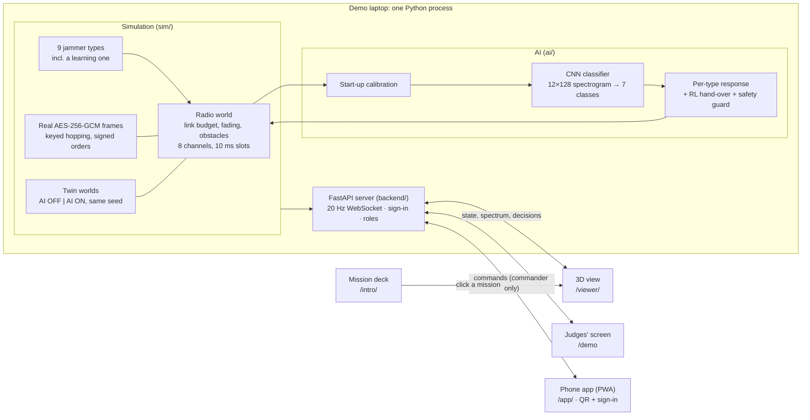

# Architecture

One Python process on the demo laptop runs the whole radio world and serves every screen. The screens are thin
clients: they draw what the server sends and send back commands. Nothing needs the internet at demo time.

## The loop, every 10 ms slot

1. **Radio world** (`sim/network.py`, `sim/radio.py`): positions move (drones on paths, trucks on roads). The
   simulation computes path loss, fading and obstacle loss for every link, then the SINR on the current channel
   with every jammer's contribution.
2. **Packets** (`sim/qos.py`, `sim/security.py`): each node generates telemetry, video and command traffic by
   priority. Every packet is a real 58-byte AES-256-GCM frame. Delivery depends on SINR and the modulation in use.
3. **Sensing** (`ai/features.py`, `ai/calibration.py`): nodes report energy per channel. On request the defender
   gets a 12×128 spectrogram window, corrected by the start-up calibration.
4. **Decision** (`ai/defender.py`): the CNN (`ai/cnn.py`, NumPy inference, about 2 ms) classifies the window.
   The defender picks a response for that jammer type. An open-set check (`ai/ood.py`) says "unknown" instead of
   guessing, and the hybrid hands over to the RL agent (`ai/rl.py`) when stuck.
5. **Safety guard** (`sim/safety.py`): every AI decision is checked before it is sent and undone if it made
   things worse.
6. **Control frame**: the decision travels as a signed, authenticated frame. It only takes effect once it is
   delivered, so a jammed control channel delays the response, as it would in reality.

Twin worlds run the same seed and the same attack, one with fixed hopping (AI OFF) and one with the AI (AI ON),
so the screens can compare them side by side.

## The server (`backend/`)

| File | Role |
|---|---|
| `app.py` | HTTP endpoints, the `/ws` WebSocket, static screens, the tick loop (simulation in a worker thread so I/O never stalls) |
| `auth.py` | Accounts, roles, join code, sessions, lockout (see [SECURITY.md](SECURITY.md)) |
| `users.py` | `python -m backend.users` account management |
| `commands.py` | Every command a screen may send, validated with Pydantic |
| `protocol.py` | Message envelope and constants; the contract itself is `shared/schema.json` |
| `world_api.py`, `fake_world.py` | The World interface, and a lightweight fake world for UI work |

Every message follows `shared/schema.json`. The tests validate every message type against it.

## The screens

| Screen | Tech | Notes |
|---|---|---|
| Mission deck `/intro/` | React 18, react-three-fiber, framer-motion | 3D voxel world per mission; the globe-spin transition; deep-links into the 3D view |
| 3D view `/viewer/` | Three.js (vendored, offline) | Live network, jammers, spectrum, AI decisions, result card and downloadable report |
| Judges' screen `/demo` | Plain HTML | 3D view, a live phone frame and the join QR |
| Phone app `/app/` | React PWA built with Vite | Sign-in, Home / Attack / Missions / More; launches jammers, compares AI OFF vs ON |
| Debug console `/` | Plain HTML | Every command and the raw state |

## Reproducibility

Everything random comes from a seed: positions, fading, jammer behaviour, keys. Two runs with the same seed give
the same packets, decisions and numbers. The benchmark, robustness sweep, stress test and truck-speed check all
rely on this. Each one prints the command that reproduces it ([EVIDENCE.md](EVIDENCE.md)).
