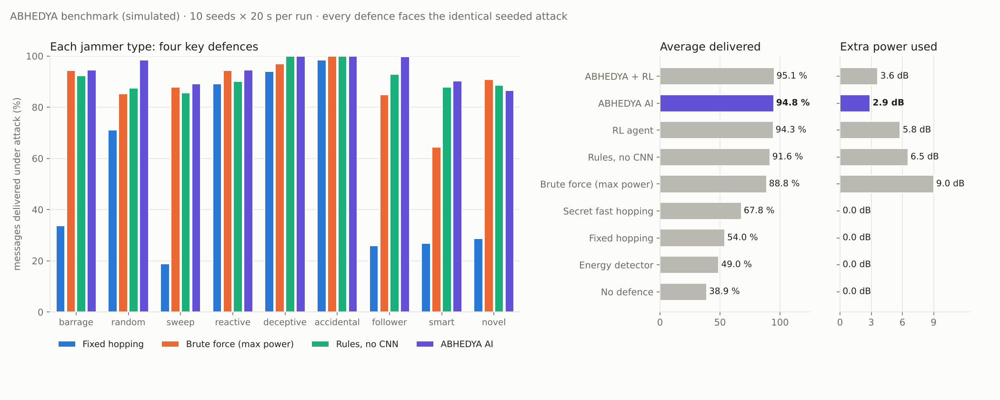

# Benchmark

`python -m sim.benchmark --seeds 10 --duration 20` (2026-11-21 21:01:26). Nine defences × nine jammer
types × 10 seeds = 810 runs of 20 s each. The jammer switches on at 2 s and is placed at
a seeded random position. **Every defence faces the identical attack** for a given seed. Every run starts with an empty
unknown-jammer memory. Simulated, not measured on hardware.

What the numbers mean, the paired statistics and the limits are in **[EVIDENCE.md](EVIDENCE.md)**. This page has the
full tables.

## Delivered under attack, per jammer type

| Jammer | No defence | Fixed hopping (FHSS) | Energy detector | Secret fast hopping | Brute force (max power + BPSK) | Rule-based adaptive (no CNN) | RL agent (Q-learning) | ABHEDYA AI | Hybrid (ABHEDYA + RL) |
|---|---|---|---|---|---|---|---|---|---|
| barrage | 33.7 % | 33.7 % | 33.7 % | 33.7 % | 94.3 % | 92.3 % | 92.4 % | 94.6 % | 94.6 % |
| random | 73.0 % | 71.1 % | 90.6 % | 70.6 % | 85.2 % | 87.4 % | 97.3 % | 98.4 % | 98.4 % |
| sweep | 18.9 % | 18.9 % | 18.9 % | 18.9 % | 87.9 % | 85.6 % | 85.5 % | 89.1 % | 89.1 % |
| reactive | 14.3 % | 89.1 % | 26.7 % | 89.2 % | 94.4 % | 90.0 % | 93.1 % | 94.6 % | 94.6 % |
| deceptive | 53.5 % | 94.0 % | 99.9 % | 94.0 % | 97.0 % | 99.9 % | 99.2 % | 99.9 % | 99.9 % |
| accidental | 88.9 % | 98.4 % | 100.0 % | 98.3 % | 100.0 % | 99.9 % | 99.6 % | 100.0 % | 100.0 % |
| follower | 24.7 % | 25.8 % | 26.1 % | 90.2 % | 84.8 % | 92.9 % | 98.6 % | 99.8 % | 99.8 % |
| smart | 14.4 % | 26.8 % | 16.4 % | 86.4 % | 64.4 % | 87.8 % | 94.8 % | 90.2 % | 93.1 % |
| novel | 28.6 % | 28.6 % | 28.6 % | 28.6 % | 90.8 % | 88.6 % | 88.6 % | 86.6 % | 86.8 % |
| **mean** | **38.9 %** | **54.0 %** | **49.0 %** | **67.8 %** | **88.8 %** | **91.6 %** | **94.3 %** | **94.8 %** | **95.1 %** |

## The three that matter: mean ± SD over seeds

The fair comparison is AI vs rules that have the same tools (power, BPSK, blacklisting) but no classifier.

| Jammer | Fixed hopping | Rules, no CNN | ABHEDYA AI | AI 95 % CI | AI worst run | AI extra power |
|---|---|---|---|---|---|---|
| barrage | 33.7 ± 22.9 | 92.3 ± 6.5 | **94.6 ± 5.9** | 90.4–98.8 | 78.2 | 8.73 dB |
| random | 71.1 ± 2.1 | 87.4 ± 5.2 | **98.4 ± 1.0** | 97.7–99.1 | 96.9 | 0.0 dB |
| sweep | 18.9 ± 12.7 | 85.6 ± 7.1 | **89.1 ± 6.9** | 84.1–94.0 | 75.4 | 8.95 dB |
| reactive | 89.1 ± 0.9 | 90.0 ± 2.8 | **94.6 ± 0.5** | 94.2–94.9 | 94.1 | 0.0 dB |
| deceptive | 94.0 ± 2.1 | 99.9 ± 0.0 | **99.9 ± 0.0** | 99.9–100.0 | 99.9 | 0.0 dB |
| accidental | 98.4 ± 0.6 | 99.9 ± 0.0 | **100.0 ± 0.1** | 99.9–100.0 | 99.9 | 0.0 dB |
| follower | 25.8 ± 27.6 | 92.9 ± 3.8 | **99.8 ± 0.1** | 99.7–99.8 | 99.7 | 0.0 dB |
| smart | 26.8 ± 4.5 | 87.8 ± 4.3 | **90.2 ± 1.6** | 89.0–91.3 | 87.6 | 0.0 dB |
| novel | 28.6 ± 16.6 | 88.6 ± 6.7 | **86.6 ± 6.3** | 82.0–91.1 | 76.5 | 8.34 dB |

## The defences

| Key | What it does |
|---|---|
| `none` | stays on one channel |
| `fixed_hopping` | conventional FHSS: a public repeating pattern (the "AI OFF" side of the demo) |
| `energy` | hops to the quietest channel when loss passes 10 % |
| `fhss_keyed` | secret fast hopping from the first slot (keyed pseudo-random pattern) |
| `max_power` | brute force: fixed hopping at +9 dB and BPSK all the time |
| `afh_power` | the AI's toolbox driven by rules: blacklist hot channels, then raise power, then BPSK; step down when quiet |
| `rl` | tabular Q-learning agent trained in this simulator |
| `aegis` | **ABHEDYA AI**: CNN classifies the jammer, then a per-type response (`ai/defender.py`) |
| `hybrid` | ABHEDYA AI, handing over to the RL agent when stuck or when the attack keeps changing |

The jammer types: barrage, random, sweep, reactive, deceptive (forged frames), accidental (a friendly Wi-Fi-like
emitter), follower, smart (changes tactic every second) and novel (a comb pattern the CNN never saw in training;
not scored for classification accuracy). A second unseen pattern, a staircase, is in `ROBUSTNESS.md`.

Raw per-run results (`runs`) and the paired comparisons (`paired`) are in `benchmark_results.json`.
